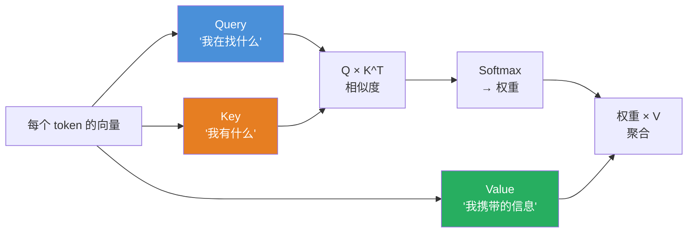

# 注意力机制（Attention）

#核心机制 #attention

## 一句话
模型在处理一个词时，动态判断句中其他每个词跟它"有多相关"，给高相关的词分配高权重。

## 关键点
- **无视距离**：相隔 15 个词的"他"和"约翰"一样能被关联
- Attention 的"权重" = 当前输出中每个位置的**贡献倍数**，不是"加减法"
- 权重完全**动态**：同一句子换一种问法，全部重算

## 降维映射
在地铁车厢里找朋友——不是从头走到尾逐个排查，而是瞬间对所有面孔做一次相似度对比，高相似度的被聚焦。

## 认知盲区
❌ 以为 Attention 的权重是做向量加减法的 → ✅ 它是判断"谁更重要"的探照灯。

---

## 🧪 摸底自测

#### Q1（入门）
> Self-Attention 的核心公式是什么？为什么算出来的是"每个词对其他词的关注程度"？

点击查看解答思路

公式：Attention(Q,K,V) = softmax(QK^T/√d_k)V  。Q和K做点积得到"相似度分数"，除以√d_k防止softmax进入极端区，softmax归一化成概率权重，最后用权重加权求和V。

#### Q2（进阶）
> Attention 计算中存在一个"反直觉"的问题：对于长序列（比如 100K tokens），Attention 的计算量会爆炸。为什么？

点击查看解答思路

Attention 的计算复杂度是 O(n²)——每两个 token 之间都要算一次相似度。序列长度翻 10 倍，计算量翻 100 倍。这就是为什么 FlashAttention 等优化那么重要。

#### Q3（思考）
> 为什么 Attention 的 Q、K、V 来自同一个输入（Self-Attention），而不是各自不同的来源？

点击查看解答思路

Self-Attention 的 Q/K/V 都来自同一序列，目的是让每个位置"看看序列中其他位置有什么值得关注的信息"。如果来自不同序列（Cross-Attention），目的是"看另一个序列的信息"——这在 Encoder-Decoder 架构中用于翻译任务。

## 参见
- [[Embedding]] — Attention 在 Embedding 空间里工作
- [[Transformer]] — Attention 是 Transformer 的核心组件
- [[Latent Space]] — 聚焦操作发生的战场

## 参考文献
- Vaswani, A. et al. (2017). *Attention Is All You Need*. NeurIPS.
- Bahdanau, D. et al. (2014). *Neural Machine Translation by Jointly Learning to Align and Translate*. ICLR.
- Dao, T. et al. (2022). *FlashAttention: Fast and Memory-Efficient Exact Attention with IO-Awareness*. NeurIPS.
