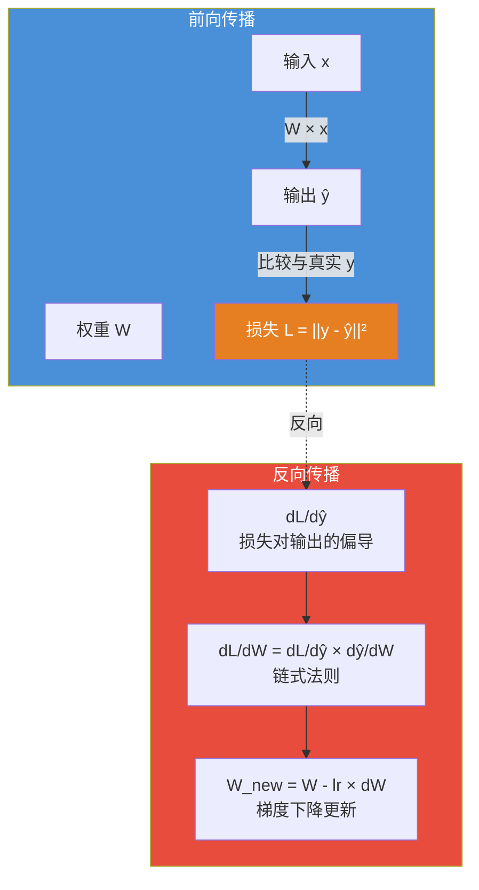

# 反向传播（Backpropagation）

#核心机制 #反向传播

## 一句话
把损失值从输出层"往回传"，通过链式法则算出每个权重该调多少、往哪调——让一个损失值变成 1000 个权重的独立调整指令。



## 核心思想

**前向传播**：信号从输入流到输出，得到损失值。  
**反向传播**：损失值从输出流回每个权重，计算梯度。

```
输入 → [前向传播] → 输出 → 损失函数 → 0.37
                                         ↓
权重 ← [反向传播] ← 损失值流回每个权重
  ↓
(每个权重按各自的梯度微调)
  ↓
下一轮前向传播 → 损失值更小
```

## 核心工具：链式法则

链式法则不做"试"——它直接算出每个权重变化对损失的影响。

**手动试的方法**：把 w₁ 加 0.01，看损失变多少 → 效率极低，1000 个权重要试 1000 次。

**链式法则的方法**：每一层都存了一个"局部敏感度"（自己这层对上游变化的放大倍数），然后把所有倍数沿路径乘回去。

### 具体流程

```
       层1          层2          损失
w₁ ─────→ y ───────→ z ─────────→ L
     ×4         ×(-12)
                         ↓
              (-12) × 4 = -48
                    ↕
             w₁ 的梯度 = -48
```

**w₁ 每增加 1，L 减少 48** → 往大调 w₁。

## 为什么能用一个数字指导 1000 个权重？

因为每个权重都有一条不同的"路径"回到损失值。路径上的局部敏感度是各自独立算的，只是沿着各自的路乘回去。

**不是喊一句"向左转"，而是给 1000 个士兵下了 1000 条不同的指令。**

## 关键认知

- 不需要"试方向"——链式法则一次算出所有梯度
- 每个权重的梯度方向可能不同 —— w₁ 要调大，w₂ 可能要调小
- 梯度的大小 = 这个权重对最终损失的影响程度

---

## 🧪 摸底自测

#### Q1（入门）
> 反向传播的核心数学原理是什么？为什么叫"反向"？

<details>
<summary>点击查看解答思路</summary>

核心是链式法则（Chain Rule）：loss 对某一层权重的偏导 = loss 对输出的偏导 × 输出对该权重的偏导。叫"反向"是因为计算方向是从输出层往输入层反着推——先算最后一层的梯度，再逐层往前传。
</details>

#### Q2（进阶）
> 如果网络有 100 层，反向传播时靠近输入层的梯度和靠近输出层的梯度有什么不同？这和梯度消失有什么关系？

<details>
<summary>点击查看解答思路</summary>

链式法则涉及多步偏导相乘。如果每步偏导都小于 1，100 层相乘后梯度趋向 0（梯度消失），靠近输入层的参数几乎更新不动。这就是为什么需要残差连接和 LayerNorm。
</details>

## 参见
- [[LossFunction]] — 反向传播的起点：损失值怎么算出来的
- [[Optimizer]] — 拿到梯度之后怎么更新权重
- [[神经网络]] — 被反向传播训练的底层单元

## 参考文献
- Rumelhart, D. E., Hinton, G. E., & Williams, R. J. (1986). *Learning representations by back-propagating errors*. Nature.
- LeCun, Y. et al. (1989). *Backpropagation Applied to Handwritten Zip Code Recognition*. Neural Computation.
