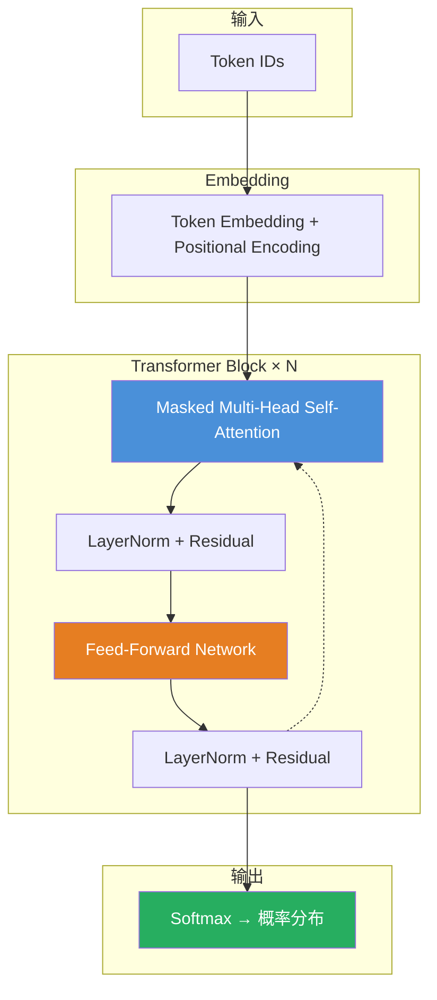

# 变换器（Transformer）

#核心机制 #transformer

## 一句话
把 Embedding、多头注意力、前馈网络、残差连接、层归一化全部组装在一起，堆叠几十层构成的完整架构。现代所有大语言模型（GPT、Claude、LLaMA等）的底层骨架。



## 核心架构（Decoder-only）

```
输入："我爱"
    │
    ▼
┌───────────────────────────────┐
│   Token Embedding             │  每个 token → 768维向量
│   + Positional Encoding       │  加上位置信号（RoPE）
└──────────┬────────────────────┘
           │
    ┌──────┴──────┐            ← 一个 Transformer Block
    │  Multi-Head               │  多个 Attention 同时工作
    │  Self-Attention           │  各抓各的关系，最后拼起来
    │        │                  │
    │  + Add (残差连接)          │  输出 = Attention结果 + 原始输入
    │  + LayerNorm (层归一化)    │  把数字拉回合理范围
    ├──────────┼────────────────┤
    │  Feed-Forward             │  MLP：放大→激活→缩小
    │  Network (FFN)            │  先放大4倍 → ReLU → 再缩小
    │        │                  │
    │  + Add (残差连接)          │  输出 = FFN结果 + Attention输出
    │  + LayerNorm (层归一化)    │  再归一化一次
    └──────────┼────────────────┘
           │
    ┌───────┘
    │  重复 N 层（GPT-3=96层）
    ▼
┌───────────────────────────────┐
│  输出层 (LM Head)             │  一次线性变换 + Softmax
└──────────┬────────────────────┘
           │
           ▼
       下一个 token 的概率分布
```

## 核心组件拆解

### 1. Multi-Head Self-Attention（多头自注意力）

**问题**：单头 Attention 只能捕捉一种"关联模式"。一句话"他在公园和我吵架后送了我一束花"，需要同时关注"谁送花→他"、"在哪吵架→公园"、"送了什么→花"，一个头不够用。

**做法**：并行开 N 个 Attention 头（GPT-3 是 96 头），每个头独立计算自己的注意力权重，最后把 N 个结果拼起来再过一次线性变换。

**降维映射**：让 8 个分析员看同一份报告，A 只看金额相关，B 只看人名相关，C 只看日期相关……最后拼成一个完整的多维分析。

### 2. Feed-Forward Network（前馈网络，FFN）

实际上就是一个两层 MLP：
```
FFN(x) = W₂ · ReLU(W₁ · x + b₁) + b₂
```
- 先把输入放大 4 倍（如 768 → 3072 维）
- 经过 ReLU 激活函数
- 再缩小回原维度（3072 → 768）

**每一层的 Attention 负责"找人"（哪里该看），FFN 负责"干活"（对找到的信息做计算加工）。**

### 3. Residual Connection（残差连接，Add）

**问题**：信号经过 96 层，每层都在被"改写"，信息会逐层稀释乃至消失。

**做法**：
```
每一层的输出 = 这一层处理的结果 + 这一层的原始输入
```

相当于每一层不是在改写信息，而是**补充信息**。第 96 层依然能拿到原始的输入信号。

**降维映射**：传话游戏中，第一个人说的话写在纸条上传给每个人——每个人看完纸条、加上自己的话，再把纸条传下去。最后一个人手里有原始信息 + 所有人补充的内容。

### 4. Layer Normalization（层归一化）

**问题**：经过层层运算，数字可能会变得极大（几万）或极小（0.0001），导致后续层的梯度爆炸或消失。

**做法**：把当前层所有神经元的输出值做一次"规整"——减去均值、除以标准差，使输出稳定在均值 0、方差 1 的范围内。

### 5. Stacking（堆叠）

同样的 Transformer Block 重复 N 层。GPT-3 有 96 层。

- 第 1～几层：看相邻词对关系（"我爱"）
- 中间层：看长程语义结构（"他在公园和我吵架"的关系）
- 深层：看抽象主旨（"整段话想表达什么"）

**每多一层，模型的"理解半径"就更大一步。**

## 完整数据流

以输入"我爱"为例：
1. **Tokenization**：切分成 ["我", "爱"] 两个 token
2. **Embedding**：每个 token → 768 维向量
3. **Positional Encoding**：加上位置信号（告诉模型"我"是第 1 位，"爱"是第 2 位）
4. **进入 Block 1**：
   - Multi-Head Attention："我"和"爱"各自关注对方→计算相关性
   - 残差连接：加上原始输入
   - 层归一化：规整数值
   - FFN：对注意力结果做进一步加工
   - 残差连接：加上 Attention 输出
   - 层归一化：规整数值
5. **进入 Block 2～N**：重复第 4 步
6. **输出层（LM Head）**：最后一层的输出 → 一次线性变换 → Softmax → 下一个 token 的概率分布

## 认知盲区

❌ "Transformer 是一个巨大的神经网络" → ✅ Transformer 是由完全相同的 Block 堆叠多次组成的，每个 Block 内部由 Attention 和 FFN 两个核心部件构成。

❌ "Attention 就是 Transformer 的全部" → ✅ Attention 只是 Transformer 的一半。另一半 FFN（MLP）承担了绝大部分的参数量和计算量。

## 降维映射总览

> Transformer 像一个**工厂流水线**：
> - Embedding = 原材料分拣上架
> - Positional Encoding = 标签贴位置号
> - Multi-Head Attention = 多个质检员同时从不同角度检查产品质量
> - 残差连接 = 每道工序之后保留原始工单
> - LayerNorm = 每个工位后的标准量具
> - FFN = 实际加工改造的工位
> - Stacking = 重复同样工艺的 N 个车间
> - LM Head = 最后的总装和发货

---

## 🧪 摸底自测

#### Q1（入门）
> Transformer 的整体架构是什么？Decoder-only 架构和 Encoder-Decoder 架构的核心区别是什么？

<details>
<summary>点击查看解答思路</summary>

完整的 Transformer = Encoder（双向注意力）+ Decoder（单向注意力 + Cross-Attention）。但现代 LLM（GPT、Claude）几乎全是 Decoder-only 架构——不需要编码器，因为任务不是"翻译"而是"续写"。Decoder-only 的因果注意力保证了每一步只能看之前的内容。
</details>

#### Q2（进阶）
> Multi-Head Attention 为什么需要用多个头？一个头不够吗？

<details>
<summary>点击查看解答思路</summary>

一个 Attention 头只能捕捉"一种关注模式"（比如语法关系 OR 语义相似度 OR 位置关系）。多个头可以并行关注不同方面的关系——有的头关注主语-动词关系，有的头关注代词-指代关系，有的头关注位置邻近关系。最后把所有头的结果拼接起来，得到更丰富的表示。
</details>

#### Q3（思考）
> 为什么 Transformer 需要 Positional Encoding？Self-Attention 本身不是"看不到位置"吗？

<details>
<summary>点击查看解答思路</summary>

Self-Attention 是对"集合"做运算——它处理的是"一组向量"，不区分顺序（"I love you"和"you love I" 在不加位置编码的条件下，Attention 看到的是同一组向量/词）。Positional Encoding 给每个位置一个独特的"位置信号"，让模型知道 token 的先后顺序。
</details>

## 参见
- [[注意力机制（Attention）]] — Transformer 的左半核心
- [[嵌入（Embedding）]] — 输入的第一道门
- [[大语言模型（LLM）]] — Transformer 是其底层架构
- [[潜空间（Latent Space）]] — 所有运算发生的战场
- [[自回归解码（Autoregressive Decoding）]] — Transformer 的输出方式
- [[FFN]] — 每个 Block 中的计算核心
- [[ResidualLayerNorm]] — 深层稳定的结构胶水
- [[Softmax]] — 输出层的最终概率化
- [[Positional Encoding]] — 让模型知道 token 顺序

## 参考文献
- Vaswani, A. et al. (2017). *Attention Is All You Need*. NeurIPS.
- Devlin, J. et al. (2018). *BERT: Pre-training of Deep Bidirectional Transformers*. NAACL.
- Brown, T. et al. (2020). *Language Models are Few-Shot Learners* (GPT-3). NeurIPS.
- Radford, A. et al. (2018). *Improving Language Understanding by Generative Pre-Training* (GPT-1). OpenAI.
