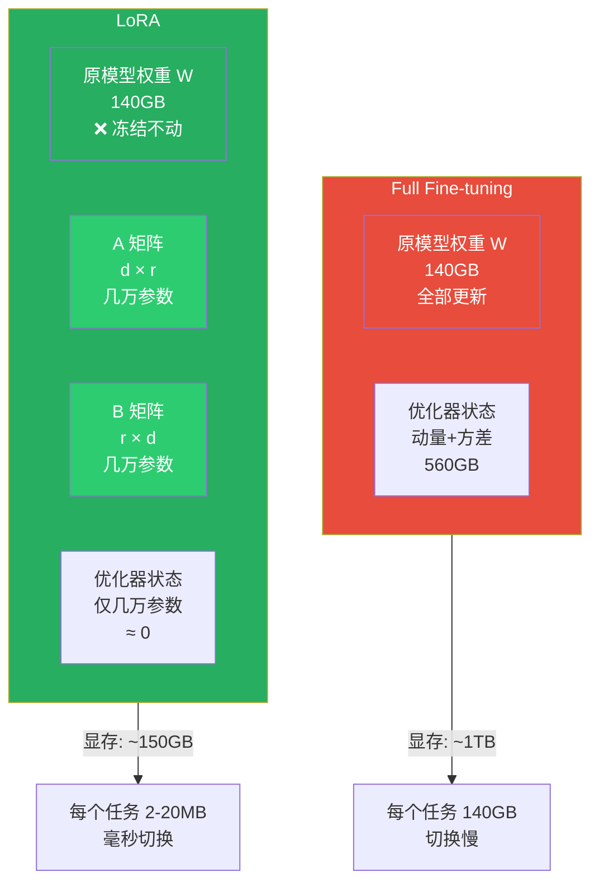

# 低秩适配（LoRA, Low-Rank Adaptation）

> ✅ 已学习 — 2026-05-18
>
> LoRA 是 Fine-tuning 的"轻量化变体"——**不改原模型权重，在旁边加极小的适配器**。
> 目标：用 0.1% 的参数更新量，达到接近 Full Fine-tuning 的效果。

---

## 一句话本质

**LoRA = 不碰原模型权重（冻结），插入两个小矩阵 A×B（可训练）**

```
Full Fine-tuning：   W' = W + ΔW        （ΔW 和 W 一样大，140GB）
LoRA：               W' = W + α·A·B / r （A×B 只有几万参数，2-20 MB）
```

---

## 为什么要 LoRA：Full Fine-tuning 的显存噩梦

训练一个 70B 模型需要的显存：

```
模型权重（FP16）：  140 GB
梯度（FP16）：       140 GB
Adam 动量（FP32）：  280 GB
Adam 方差（FP32）：  280 GB
中间激活值：         几十 ~ 几百 GB

合计：~1 TB 显存 ≈ 13 张 H100 80GB
```

**部署的噩梦：**

```
Fine-tune 了 5 个不同任务：
  法律模型、医疗模型、客服模型、翻译模型、代码助手

Full FT 存储：5 × 140 GB = 700 GB
LoRA 存储：   5 × 20 MB + 1 × 140 GB（原模型）≈ 140.1 GB
```

---

## LoRA 的核心机制

### 数学原理

```
原来要改的权重矩阵 W：d × d（比如 4096 × 4096）= 16,777,216 参数

LoRA 的做法：
  A 矩阵：d × r（4096 × 8）= 32,768 参数  ← "压缩"
  B 矩阵：r × d（8 × 4096）= 32,768 参数  ← "解压"
  合计：65,536 参数

比例：65,536 / 16,777,216 ≈ 0.4%
```

**为什么有效？**

论文发现：Fine-tuning 时权重的变化量（ΔW）具有"低秩"性质——**真正的改变方向信息量很小，不需要千万级维度来承载**。

### 超参数

```
r（秩）：控制适配器大小
  r=1  → 极轻微调整
  r=64 → 更复杂的调整，参数多 64 倍
  经验值：r=8 或 r=16 对大多数任务够用

α（缩放系数）：控制 LoRA 的影响强度
  经验值：α 通常设成 r 的 2 倍
  α/r 越大 → LoRA 的修正越强

target_modules：作用在哪些层？
  通常只作用在 Attention 的 Q、K、V、O 投影层
  可以扩展到 FFN 层，但不是必须
```

---

## LoRA vs Full Fine-tuning



| 维度 | Full Fine-tuning | LoRA |
|---|---|---|
| **更新参数** | 全部（70B） | 极少量（~6万） |
| **训练显存** | 13× H100 | 1× H100 |
| **训练时间** | 几天~几周 | 几小时~一天 |
| **存储每个任务** | 140 GB | 2-20 MB |
| **切换任务** | 几分钟（重加载） | 毫秒级（热插拔适配器） |
| **原模型能力** | 可能遗忘（灾难性遗忘） | 完全保留 |
| **多任务部署** | 极其困难 | 极其方便 |

---

## QLoRA：LoRA 的进一步压缩

**Q = Quantized（量化）**

```
LoRA：   权重用 FP16（2 字节/参数）+ 小适配器
QLoRA：  权重用 INT4（0.5 字节/参数）+ 小适配器

显存需求：
  LoRA 70B：  ~80 GB（1× H100）
  QLoRA 70B： ~24 GB（1× RTX 4090）
```

**代价：** 训练慢 20-30%，效果略差（量化精度损失）

**选择原则：**

```
有 H100 → 用 LoRA（更快，效果略好）
只有消费卡（RTX 4090 / 3090）→ 用 QLoRA（唯一能在消费卡上跑的方案）
```

---

## 降维映射

```
Full Fine-tuning = 把整面墙铲掉重刷
  要记录所有材料的用量和位置（优化器状态）
  换一幅画就要整面墙重做

LoRA = 在墙上挂画框
  墙（原模型）不动
  换画只需换画框（适配器文件）
  100 幅画只需要 100 个画框 + 1 面墙
```

---

## 训练视角对比

```
Full Fine-tuning 时：
  模型权重（140GB）→ 冻结？不，全部更新
  Adam 要为 70B 参数存动量和方差

LoRA 时：
  模型权重（140GB）→ 冻结，只加载进显存
  Adam 只为 A 和 B（~6万参数）存动量和方差
  → 显存占用 ≈ 150 GB（主要是 W 的 140 GB）

QLoRA 时：
  模型权重用 INT4（~35GB）→ 冻结
  Adam 只为 A 和 B 存状态
  → 显存占用 ≈ 24 GB
```

---

## 🧪 摸底自测

#### Q1（入门）
> 为什么要用 LoRA 而不是 Full Fine-tuning？LoRA 省在哪里？

<details>
<summary>解答</summary>

Full Fine-tuning 要更新全部 70B 参数，Adam 要为 70B 参数存动量和方差 → ~1TB 显存。LoRA 冻结原权重，只更新两个小矩阵（A×B，几万参数）→ 显存降至 ~150GB。省在优化器状态从 560GB 降到几 MB。
</details>

#### Q2（进阶）
> LoRA 的 r（秩）控制什么？r=8 和 r=64 分别适合什么场景？

<details>
<summary>解答</summary>

r 控制适配器的大小（压缩维度）。r 越大适配器参数越多，能做的调整越复杂。r=8 适合简单任务（风格微调、格式对齐），r=64 适合复杂任务（需要较大行为改变的微调）。经验值：大多数任务 r=8 或 r=16 就够。
</details>

#### Q3（提升）
> QLoRA 比 LoRA 多做了什么？什么情况下必须用 QLoRA？

<details>
<summary>解答</summary>

QLoRA 在原模型权重上做了量化（FP16 → INT4），进一步压缩显存。70B 模型从 ~150GB（LoRA）降到 ~24GB（QLoRA）。必须用 QLoRA 的场景：只有消费级显卡（RTX 4090 24GB），没有 H100 等专业卡。
</details>

---

## 参考文献
- Hu, E. et al. (2021). *LoRA: Low-Rank Adaptation of Large Language Models*. ICLR.
- Dettmers, T. et al. (2023). *QLoRA: Efficient Finetuning of Quantized Language Models*. NeurIPS.
- Mangrulkar, S. et al. (2022). *PEFT: State-of-the-art Parameter-Efficient Fine-Tuning*. GitHub.

*关联阅读：[[Fine-tuning]] · [[SFT（监督微调）]] · [[模型量化]]*
