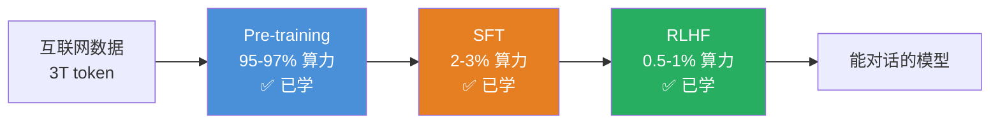

# 预训练（Pre-training）

> ✅ 已学习 — 2026-05-18
>
> Pre-training 是整条训练流水线中 **最重、最耗钱、最核心** 的一环（占 95%+ 的计算量）。
> Pre-training 之后的模型不是 AI 助手——它只是一个"疯狂续写机器"。

---

## 一句话本质

**让模型在互联网海量文本上重复做一件傻事：猜下一个 token。**

猜对了，参数往正确的方向微调一点；猜错了，参数往损失更小的方向调整。3 万亿次之后，模型"学会"了语言。

---

## 训练全景定位



Pre-training 产出：**不是 AI 助手，是下一个 token 预测器。**

```
你输入：北京是中国的
模型输出：古都之一，历史悠久……
         （或者）首都，位于华北平原……
         （甚至）政治文化中心…… → 它在"续写"，不是在"回答"
```

---

## 机械流程（单步完整闭环）

```
① 初始化参数 ──→ ② 取一个 batch ──→ ③ 前向传播 ──→ ④ 算 Loss
     ↑                                        ↓
     │                              反向传播算出梯度
     │                                        ↓
     │                              ⑤ Ring All-Reduce 平均梯度
     │                                        ↓
     ⑧ 下一个 batch ←─── ⑦ 下一个 step ←─── ⑥ 优化器更新参数
```

### ① 参数初始化

参数不能全 0（每层输出一样，网络"死"了），不能全 1（梯度爆炸），需要**控制方差的随机初始化**：

```
Xavier 初始化：方差 = 1 / √(输入维度)
Kaiming 初始化：方差 = 2 / √(输入维度)（ReLU 专用）

降维映射：
  让大家分布在一个合理半径内，信息才能有效传递和收敛。
  太集中 → 所有人都说一样的话（方差太小）
  太分散 → 谁也找不到谁（方差太大 → NaN）
```

### ② 取 batch

```
一个 batch = 4096 个序列 × 4096 个 token = 约 1600 万 token
```

### ③ 前向传播

每个 token 经过：Embedding → Transformer 层（Attention + FFN）× N → 输出概率分布（100K 维，每个 token 一个概率）

### ④ 损失函数：Cross-Entropy Loss

```
任务名：Next Token Prediction（下一个 token 预测）
        也叫 Autoregressive Language Modeling

数学形式：
  Loss = -log(P(正确 token))
  
  如果模型给"首都"的概率是 0.7 → Loss = -log(0.7) ≈ 0.36（小，好）
  如果模型给"首都"的概率是 0.01 → Loss = -log(0.01) ≈ 4.6（大，差）
```

### ⑤ Ring All-Reduce：多 GPU 梯度合并

```
不用"主卡接收"方案（会成为瓶颈）——用环形拓扑：

  每张 GPU 把自己的梯度切成 N 份
  每张卡只跟左右邻居通信
  N 步后，每张卡上都有所有卡的**完整平均梯度**
  
  性质：
    ✓ 无瓶颈 — 所有卡通信量相同
    ✓ 带宽 100% 利用率 — 所有卡同时收发
    ✓ 容错 — 单卡崩溃不影响其他卡（从 checkpoint 重启即可）
```

### ⑥ 优化器更新参数（通常 AdamW）

```
AdamW 做的事情：
  不仅看当前梯度，还看"历史梯度的动量"
  
  降维映射：
    普通梯度下降（SGD）= 只看"这步该怎么走"
    AdamW = 不仅看这步，还看"之前一直在往哪个方向走"
          = 有惯性的下坡，不会因为一个坑就跳偏
```

### 训练规模

```
一次完整的 Pre-training（70B 模型）：
  batch size: 4096 × 4096 ≈ 1600 万 token/步
  总步数：约 200 万步
  总 token 数：约 3 万亿
  epoch：不到 1（数据多样性足够，重复就会过拟合/死记硬背）
```

---

## 数据的四层工程

### 第一层：原始数据源

```
Common Crawl：每月爬取数十亿网页，核心数据源
  Content：HTML、纯文本、元数据
  Stats：每个月数十TB的原始数据
  Issue：60%+ 是垃圾（SEO 污染、AI 废文、恶意灌水）
```

### 第二层：规则级过滤

```
① 去重（URL 去重 + MinHash 文本去重）
② 长度过滤（<50 字符的页面扔掉）
③ 语言检测（只保留目标语言）
④ 域名黑名单
```

### 第三层：模型级质量打分（核心杀招）

```
Step 1: 人工挑几千篇"标杆"高质量文本（维基百科、论文、教科书）
Step 2: 训练一个小模型（~100M BERT）做分类器
         任务：判"这个页面像不像高质量数据"
Step 3: 用分类器扫描整个 Common Crawl（~50 亿页面）
Step 4: 只保留质量分 > 阈值的页面

结果：~50 亿 → ~5 亿高质量页面

降维映射：
  不是你亲自去市场挑水果——你请了一个水果专家（小模型）帮你挑。
  专家先吃了几颗最好的水果，知道"好水果"的标准，
  然后对整批水果逐个打分，85 分以上的才进冰箱。
```

### 第四层：数据配比（商业机密级）

```
不像自然分布那样采样——人为调整配比：

自然分布（CC 天然比例）：
  普通文本：        97%
  代码+数学：       3%  ← 太少，模型数学/代码能力差

调整后（人为过采样稀缺数据）：
  普通文本：        70%
  代码+数学：       30%  ← 放大 10 倍

三层配比决策：
  第一层（粗配比）：数据源级别（文本 : 代码 : 数学 : 多语言 = 70 : 15 : 10 : 5）
  第二层（精配比）：质量分级（教科书级 > 维基级 > 新闻级 > 论坛级）
  第三层（动态配比）：训练途中根据模型表现动态调整（发现数学差就加数学权重）
```

---

## 涌现（Emergence）

### 为什么模型会翻译？

没有翻译数据，但互联网上存在大量"隐形平行语料"：

```
维基百科中英对照条目
电影字幕（中英文混排）
GitHub 文档的中英对照
论文英文正文 + 中文摘要
```

模型发现：某些英文 token 序列之后，经常跟着对应的中文 token 序列。

**翻译能力不是被训练的——是数据中交错的语言模式自发涌现的。**

### 涌现不是线性的——存在相变阈值

```
涌现强度
    │
    │           ┌──── 翻译/推理能力突然出现
    │      ┌────┘
    │  ┌───┘
    │──┘ ← 这里只会续写
    └──────────────────→ 训练 token 数
        ~1000 亿
```

从 99°C 到 100°C，水突然沸腾。它不是越来越接近沸腾，而是在临界点发生了质变。

### 涌现的三要素【短板决定天花板】

```
Emergence ≈ min(数据规模, 数据多样性(×配比), 模型容量)

① 数据规模不足 → 没有足够的统计信号
② 配比不对   → 某些能力的涌现被压制
③ 模型太小   → 同样数据，7B 看不到的规律，70B 能看到
```

---

## 核心争议：LLM 有没有世界模型？

| 统计派（LeCun） | 涌现派（Sutskever） |
|---|---|
| LLM 是"随机鹦鹉"，完美模仿了语言表面 | 统计相关性足够密时，内部形成对世界的压缩表示 |
| 模型不知道"相对论"，只知道"Einstein"和"relativity"共现 | 能推理因果链时，"知道"和"模拟知道"没有功能区别 |

**当前公允立场：模型的知识是统计压缩，但压缩得足够好时，行为等价于拥有了知识。至于是不是"真理解"——是哲学问题，不是工程问题。**

---

## 硬件要求

| 组件 | 消费级（RTX 4090） | 专业级（H100） | 为什么 |
|---|---|---|---|
| 显存 | 24GB | 80GB | 70B 模型权重就占 ~140GB |
| ECC | ❌ | ✅ | 宇宙射线翻转一个比特 → 几千万美元训练白费 |
| 互联带宽 | PCIe 4.0 ~50GB/s | NVLink ~900GB/s | 90% 时间在等通信，不是在算 |
| 功耗 | 450W | 700W | 1 万张 H100 ≈ 30MW=小型核电站 |

**结论：消费级显卡无法用于 Pre-training，差距不只是"算力"，是整个基础设施的可靠性。**

---

## 关键速记

- **核心任务**：Next Token Prediction（Cross-Entropy Loss）
- **数据量**：~3 万亿 token，不到 1 个 epoch
- **batch size**：~1600 万 token/步
- **计算占比**：占整个训练流程的 **95-97%**
- **涌现条件**：数据规模 × 多样性 × 模型容量 → 短板决定天花板
- **并行方案**：Ring All-Reduce（无瓶颈环形通信）
- **初始化**：Xavier/Kaiming（控制方差，不能全 0/全 1）
- **优化器**：AdamW（带动量的梯度下降）

---

---

## 🧪 摸底自测

> 以下问题来自三个学习轮次的摸底环节。按顺序自测，卡住的地方就是需要复习的部分。

### 第一轮：训练流水线全景

#### Q1（入门）
> 一个刚完成 Pre-training 的模型，你直接问它「北京是中国的什么？」，它大概率不会好好回答你。为什么？Pre-training 那一步到底让模型学会了什么？

<details>
<summary>点击查看解答思路</summary>

Pre-training 只做了一件事：预测下一个 token。模型不是一个 AI 助手，是一个"疯狂续写机器"——你问它问题，它以为你要它继续写小说。它学会了语言模式，没学会"回答问题"这个社交规范。
</details>

#### Q2（进阶）
> 你已经知道：SFT 是给模型看「标准问答对」，RLHF 是让人类打分来优化。那为什么有了 SFT 还不够，还要再加 RLHF？这两个阶段的本质区别是什么？

<details>
<summary>点击查看解答思路</summary>

SFT = 背标准答案（看到什么输入就模仿什么输出）。RLHF = 理解评分标准（学会"什么样的回答人类更喜欢"）。SFT 让模型学会"怎么回答"，RLHF 让模型学会"怎么回答更好"——一个是模仿，一个是泛化。
</details>

#### Q3（提升）
> 训练一个 70B 参数的模型，Pre-training、SFT、RLHF 三个阶段，你猜各自占多少计算量/时间？按数量级猜就行。

<details>
<summary>点击查看解答思路</summary>

Pre-training: 95-97% | SFT: 2-3% | RLHF: 0.5-1%。Pre-training 占绝对大头，但 RLHF 虽然计算量最小，对"模型好不好用"的影响可能最大。
</details>

### 第二轮：核心机械原理

#### Q1（入门）
> 一个 70B 参数的模型，第一次前向传播之前，这些参数的值是什么？用什么初始值？全部设成 0 行不行？全部设成 1 行不行？为什么？

<details>
<summary>点击查看解答思路</summary>

不能全 0（每层输出一样，网络"死"了），不能全 1（方差太大→NaN）。需要用 Xavier/Kaiming 初始化控制方差在 1/√(输入维度) 的量级，让每层输出在合理范围内。
</details>

#### Q2（进阶）
> Pre-training 中，模型每处理一个 batch（比如 4096 个序列 × 4096 个 token），计算出 loss，然后反向传播算出梯度。这步的梯度是平均了所有人的错误，还是每个人的错误各自独立更新？

<details>
<summary>点击查看解答思路</summary>

平均。每个序列的梯度 = 信号 + 噪声，4096 个平均后信号对齐增强、噪声互相抵消（信噪比提升 64 倍）。独立更新会让梯度方向互相打架，无法收敛。
</details>

#### Q3（提升）
> 想象你把训练分布到了 1000 张 GPU 上。每张 GPU 算完自己的梯度后，要把这 1000 份梯度合并成一份再更新参数。怎么做最快？全部传给一张主卡？还是别的方案？

<details>
<summary>点击查看解答思路</summary>

Ring All-Reduce：每张卡把自己的梯度切成 N 份，只跟左右邻居通信。N 步后每张卡都有完整的平均梯度。优点是无瓶颈、带宽 100% 利用、单卡崩溃不影响全局。
</details>

### 第三轮：数据工程

#### Q1（入门）
> Common Crawl 的原始数据里，可能 60% 以上是自动生成的垃圾页面。如果让你设计一个过滤器把垃圾筛掉，你会用什么规则来判"这个网页是垃圾"？

<details>
<summary>点击查看解答思路</summary>

规则级（去重、长度过滤、语言检测、域名黑名单）+ 模型级（用一个小分类器学习"高质量页面"的特征，对每个网页打分，保留高分页面）。后者才是真正的杀招。
</details>

#### Q2（进阶）
> 通用的网页数据里数学和代码严重不足。但大模型必须会数学和代码，怎么办？是"让模型自己从少量数据中摸索"还是"想办法找更多数学/代码数据"？

<details>
<summary>点击查看解答思路</summary>

额外补充 + 强制过采样。从 arXiv、GitHub、教科书等来源额外收集代码/数学数据，在数据配比中人为放大稀缺数据的权重（从自然分布的 3% 放大到 30%）。
</details>

#### Q3（提升）
> 当数据集加起来 15T token，而你的训练计划只要 3T token，怎么从 15T 里选出这 3T？是按比例每种数据都取 1/5，还是有的多取有的少取？

<details>
<summary>点击查看解答思路</summary>

三层配比：①粗配比（数据源级别定比例）→ ②精配比（每种数据内按质量分级）→ ③动态配比（训练途中根据模型各能力表现动态调整）。不是简单均匀采样，是精心设计的多层级决策。
</details>

---

## 参见
- [[SFT（监督微调）]] — 训练流程的下一步
- [[RLHF]] — 训练流程的最后一步
- [[Fine-tuning]] — 在预训练基础上专注的微调
- [[Tokenization]] — 输入数据的预处理
- [[Transformer]] — 预训练的底层架构
- [[Scaling Law]] — 预训练的规模定律
- [[MoE（混合专家）]] — 预训练的现代架构变体
- [[数据集构建与评估指标]] — 预训练的数据来源

## 参考文献
- Radford, A. et al. (2018). *Improving Language Understanding by Generative Pre-Training* (GPT-1). OpenAI.
- Kaplan, J. et al. (2020). *Scaling Laws for Neural Language Models*. arXiv:2001.08361.
- Hoffmann, J. et al. (2022). *Training Compute-Optimal Large Language Models* (Chinchilla). NeurIPS.
- Brown, T. et al. (2020). *Language Models are Few-Shot Learners* (GPT-3). NeurIPS.
- DeepSeek-AI. (2024). *DeepSeek-V2: A Strong, Economical, and Efficient Mixture-of-Experts Language Model*. arXiv:2405.04434.
