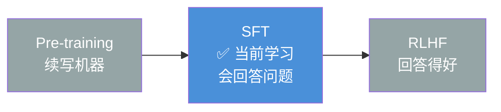

# 监督微调（SFT, Supervised Fine-Tuning）

> ✅ 已学习 — 2026-05-18
>
> SFT 是 Pre-training → SFT → RLHF 训练流水线的中段工序。
> Pre-training 产出"续写机器"，SFT 教会它"回答问题"。



---

## 一句话本质

**给模型看几万条高质量的"问题 → 标准答案"对，让它学会回答的格式和范式。**

不是教新知识，是教"怎么说话才对"。

---

## 数据格式

SFT 用的数据是标准的 **指令-回答对**：

```
{
  "instruction": "中国的首都是哪里？",
  "output": "中国的首都是北京。"
}
{
  "instruction": "解释一下什么是机器学习",
  "output": "机器学习是人工智能的一个子领域……"
}
{
  "instruction": "把这句话翻译成英文：今天天气真好",
  "output": "The weather is nice today."
}
```

**数据量级对比：**

| 阶段 | 数据量 | 来源 |
|---|---|---|
| Pre-training | ~3 万亿 token | 整个互联网原始文本 |
| SFT | ~1 万 - 10 万条 | 人工标注的高质量问答对 |

**关键认知**：SFT 不需要几十亿条数据。因为模型已经在 Pre-training 中学到了语言规律和知识，SFT 只是教它"把这些知识以问答形式输出"——几千到几万条高质量数据就够了。

---

## 核心风险：SFT 过拟合

SFT 最大的风险不是"模型学坏"，而是**过拟合到数据格式**——模型变成"范文复读机"。

```
假设 SFT 数据里只有一种回答风格：
  用户：写一首关于猫的诗
  模型：【背诵数据里那一首】

  用户：再写一首
  模型：【同样的诗，一字不差】

→ 模型学会了"回答问题"，但没学会"多样的回答方式"
→ 丧失了创造性和泛化能力
```

此外还有几个常见问题：

| 风险 | 表现 | 原因 |
|---|---|---|
| **格式过拟合** | 换种问法就答不上 | 训练数据问法单一 |
| **风格固化** | 所有回答语气一样 | 标注者风格一致 |
| **知识遗忘** | SFT 后变"笨"了 | SFT 数据覆盖的知识面太窄 |
| **幻觉固化** | 模型自信地给出错误答案 | SFT 数据里包含错误标注 |

---

## SFT vs RLHF：本质区别

```
SFT   = 背标准答案（一条指令 → 一条标准输出）
RLHF  = 理解评分标准（一条指令 → 多条输出 → 人类排序）

SFT 教："该怎么回答"
RLHF 教："什么样的回答更好"
```

**降维映射：**

```
SFT  = 高考刷题：给你答案让你背，考到原题满分，题目一变就抓瞎
RLHF = 作文老师批改：不给你标准答案，告诉你"这段好在哪里、差在哪里"
```

两者不是替代关系——**SFT 是地基，RLHF 是上层建筑**。没有 SFT，模型连"回答问题"的格式都不会；没有 RLHF，模型的回答"及格但不优秀"。

---

## SFT 在训练流水线中的位置

```
Pre-training ✅ → SFT（当前正在学）→ RLHF ✅
     |                    |               |
  语言能力 + 知识      回答格式       回答质量偏好
  95% 算力             2-3% 算力      0.5-1% 算力
```

---

## 🧪 摸底自测

#### Q1（入门）
> SFT 的全称是什么？Pre-training 产出的模型和 SFT 后的模型，行为上最大的区别是什么？

<details>
<summary>解答</summary>

Supervised Fine-Tuning（监督微调）。Pre-training 后的模型是"续写机器"——它会接着你的话写下去，但不知道你在问问题。SFT 后模型学会了"回答格式"——知道"用户提问 → 我回答"的范式。
</details>

#### Q2（进阶）
> SFT 的数据和 Pre-training 的数据有什么本质不同？量级上差多少？

<details>
<summary>解答</summary>

Pre-training 数据是互联网原始文本（3 万亿 token），没有问答对，只有"下一句话"。
SFT 数据是人工标注的指令-回答对（1万-10万条），有明确的问题和标准答案。
量级差约 1 亿倍。
</details>

#### Q3（提升）
> SFT 最大的风险是什么？它和 RLHF 的数据本质区别在哪？

<details>
<summary>解答</summary>

最大风险是"过拟合到数据格式"——模型变成范文复读机，丧失创造性和泛化能力。
SFT 数据是"一条指令 → 一条标准答案"；RLHF 数据是"一条指令 → 多条回答 → 人类排序"。
SFT 教标准答案，RLHF 教评分标准。
</details>

---

## 参考文献
- Ouyang, L. et al. (2022). *Training language models to follow instructions with human feedback* (InstructGPT). NeurIPS.
- Chung, H. W. et al. (2022). *Scaling Instruction-Finetuned Language Models* (Flan-T5). arXiv:2210.11416.
- Wei, J. et al. (2021). *Finetuned Language Models Are Zero-Shot Learners* (FLAN). ICLR.

*关联阅读：[[Pre-training]] · [[RLHF]] · [[Fine-tuning]]*
