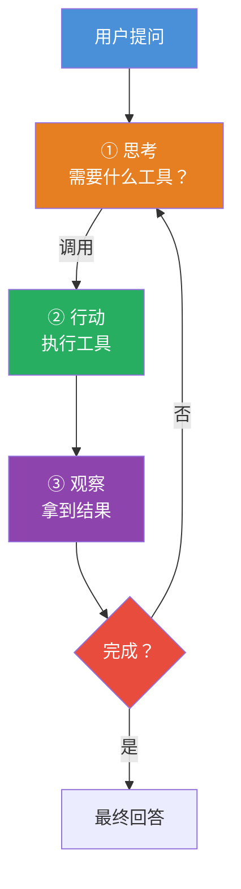

# AI 智能体（AI Agent）工作循环

> ✅ 已学习 — 2026-05-18
>
> Agent = LLM + 工具 + 循环。单次 API 调用不够，Agent 让模型可以"思考→行动→观察→再思考"多次，直到完成任务。

---

## 一句话本质

**Agent = 给模型一个循环，让它能自主规划、调用工具、观察结果、再规划，直到把事情做完。**



```
用户提问
   │
   ▼
┌─────────────────────────────────────┐
│  ① 思考（Think）                     │
│    "用户想要什么？我需要什么工具？"    │
└──────────────┬──────────────────────┘
               │
               ▼
┌─────────────────────────────────────┐
│  ② 行动（Act）                       │
│    调用工具 / 生成中间结果             │
│    比如：查天气、查数据库、搜索网页      │
└──────────────┬──────────────────────┘
               │
               ▼
┌─────────────────────────────────────┐
│  ③ 观察（Observe）                   │
│    拿到工具返回的结果                  │
│    "天气是晴天，日程有空"              │
└──────────────┬──────────────────────┘
               │
               ▼
        ┌──────────────┐
        │ 任务完成了吗？ │ ← 判断：继续循环还是最终回答
        └──────┬───────┘
        是     │     否
         │     │     └──→ 回到 ① 再思考
         ▼
   最终回答给用户
```

---

## Agent 的三个核心能力

### 1. 规划（Planning）

模型收到任务后，不是直接输出，而是先"想一下"怎么做：

```
用户：帮我安排明天的日程

好的 Agent：
  ① 查明天天气（决定是否适合户外）
  ② 查当前日程（看有哪些安排）
  ③ 查交通状况（考虑通勤时间）
  ④ 综合输出建议
```

### 2. 工具调用（Tool Use）

规划完了要执行——Function Calling 是 Agent 的"手"。

```
查天气 → get_weather(city="北京", date="明天")
查日程 → get_schedule(date="明天")
查交通 → get_traffic(city="北京")
```

### 3. 记忆（Memory）

Agent 需要在循环中"记住"之前做了什么、得到了什么结果。

```
循环到第 3 轮时，messages 里已经累积了：
  用户问题 → 模型思考 → 工具调用 → 工具结果 → 模型再思考 → ...
```

---

## 一个完整的 Agent 执行示例

```
用户：帮我规划明天的安排，看看适不适合去颐和园

第 1 轮：
  思考 → "需要查天气和日程"
  调用 → get_weather("北京", "明天")
  观察 → "晴天，22°C"

第 2 轮：
  思考 → "天气不错。再看看日程有空没"
  调用 → get_schedule("明天")
  观察 → "上午 10 点有会，下午空闲"

第 3 轮：
  思考 → "下午适合去。再查查交通"
  调用 → get_traffic("家→颐和园", "明天下午")
  观察 → "地铁 40 分钟，不堵"

第 4 轮：
  思考 → "综合所有信息，可以给出建议了"
  回答 → "明天上午有会，下午天气很好（22°C 晴），
          地铁 40 分钟到颐和园，适合下午去。建议带伞防晒。"
```

---

## Agent 的关键配置参数

你在 Agent 配置里看到的参数，对应到 Agent 循环的层面：

| 参数 | 作用 | 设得太小 | 设得太大 |
|---|---|---|---|
| **最大迭代次数** | 循环最多跑几轮 | 两轮就停，复杂任务做不完 | 可能无限循环、烧钱 |
| **温度** | 每步决策的随机性 | Agent 太死板 | Agent 可能"发挥"到跑偏 |
| **记忆轮数** | messages 保留多少轮历史 | 模型"忘了"前面做了什么 | 上下文太长、贵 |
| **工具列表** | Agent 能用的工具池 | 工具少→做不了复杂事 | 工具太多→模型选错工具 |

---

## 多 Agent 协作（主 Agent + 子 Agent）

> 你学过的单 Agent 循环是基础。工业级方案通常用多 Agent 架构。

### 为什么需要多个 Agent？

```
单 Agent 的问题：
  一个模型要同时会：
    - 理解用户意图
    - 写代码
    - 测试代码
    - 操作数据库
    - 调外部 API
    → 提示词超级长（几千 token）
    → 工具列表超级多（几十个工具）
    → 模型容易选错工具
    → 循环容易跑偏

多 Agent 的解法：
  每个 Agent 只负责一件专一的事
  → 提示词短（几百 token）
  → 工具列表少（2-3 个，不会选错）
  → 不容易跑偏
```

### 典型架构：Orchestrator Pattern

```
用户提问
     │
     ▼
┌─────────────────────────┐
│     主 Agent（协调者）    │  ← 只做规划和调度
│                         │    不负责具体执行
│  "这个任务需要3步：       │
│   ① 写代码 → 交给 Code Agent
│   ② 测试   → 交给 QA Agent  
│   ③ 部署   → 交给 Deploy Agent"
└──────┬──────┬──────┬───┘
       │      │      │
       ▼      ▼      ▼
   ┌──────┐ ┌──────┐ ┌──────┐
   │ Code  │ │  QA  │ │Deploy│  ← 子 Agent
   │Agent  │ │Agent │ │Agent │     只做一件专一的事
   └──────┘ └──────┘ └──────┘
       │      │      │
       └──────┴──────┴───┘
               │ 返回结果
               ▼
       主 Agent 汇总输出
```

### 你和这个架构的关系

你现在用的 Agent 配置，背后很可能已经是多 Agent 架构了：

```
你只看到：
  一个对话框 → 输入问题 → 得到回答

背后可能是：
  ┌─ 对话 Agent（和你聊天）
  ├─ 搜索 Agent（查资料）
  ├─ 代码 Agent（写代码）
  └─ 工具 Agent（调 API）
  
  主 Agent 帮你隐藏了这些分工。
```

### 两种模式的对比

| | 单 Agent | 主+子 Agent |
|---|---|---|
| **架构** | 一个模型干所有事 | 每个 Agent 各司其职 |
| **提示词** | 长（几千 token） | 短（几百 token） |
| **工具列表** | 多（容易选错） | 少（每个 Agent 2-3 个工具） |
| **容错** | 一个环节错全链崩 | 子 Agent 出错可替换 |
| **复杂度** | 低（适合简单任务） | 高（适合复杂工作流） |
| **成本** | 较低（单循环） | 较高（多次多模型调用） |

### 降维映射

```
单 Agent   = 一个人开饭店——洗菜、切菜、炒菜、收银全场跑
多 Agent   = 大厨（主 Agent）指挥切菜工、炒菜工、收银员
             各干各的，出错率低，效率高
```

---

## Agent vs 单次 API 调用

| | 单次 API 调用 | Agent |
|---|---|---|
| **调用次数** | 1 次 | 多次（循环） |
| **能做什么** | 生成文本 | 调用工具、多步推理 |
| **自主性** | 你说一句它回一句 | 可以自主规划执行步骤 |
| **复杂度** | 简单问答、翻译 | 复杂任务、多步骤操作 |
| **成本** | 一次的钱 | 多轮调用的钱 |
| **延迟** | 几秒 | 几十秒到几分钟 |

---

## 当前 Agent 的局限

| 局限 | 表现 | 原因 |
|---|---|---|
| **循环跑偏** | Agent 在工具调用中越绕越远 | 缺乏"什么时候该停"的判断 |
| **幻觉放大** | 工具返回错误数据，模型在此基础上继续推理 | 错误在循环中累积 |
| **成本不可控** | 一个复杂任务可能调几十次 API | 迭代次数没设上限 |
| **工具选择错误** | 工具多了模型会选错 | 选项越多决策越差 |

---

## 🧪 摸底自测

#### Q1（入门）
> Agent 和普通 API 调用的本质区别是什么？

<details>
<summary>解答</summary>

普通 API 调用是一次问答；Agent 是多次循环：思考→行动→观察→再思考→...直到完成任务。Agent 可以调用工具、多步推理。
</details>

#### Q2（进阶）
> Agent 的三核心能力是哪三个？

<details>
<summary>解答</summary>

①规划（Plan）— 分解任务、决定步骤；②工具调用（Tool Use）— 用 Function Calling 执行操作；③记忆（Memory）— 在循环中记住之前的步骤和结果。
</details>

#### Q3（思考）
> Agent 配置里的"最大迭代次数"实际控制什么？设成 1 会怎样？

<details>
<summary>解答</summary>

控制循环最多转几圈。设成 1 → 模型只能做单次工具调用，无法根据结果再规划→ 只能做"查一下"不能做"查完再决定"。设得太大→可能无限循环烧钱。
</details>

---

## 参考文献
- Yao, S. et al. (2022). *ReAct: Synergizing Reasoning and Acting in Language Models*. ICLR.
- Wang, L. et al. (2023). *A Survey on Large Language Model based Autonomous Agents*. arXiv:2308.11432.
- Xi, Z. et al. (2023). *The Rise and Potential of Large Language Model Based Agents: A Survey*. arXiv:2309.07864.

*关联阅读：[[Function Calling]] · [[MCP（模型上下文协议）]] · [[Prompt Engineering]] · [[API 调用基础与流式输出]]*
