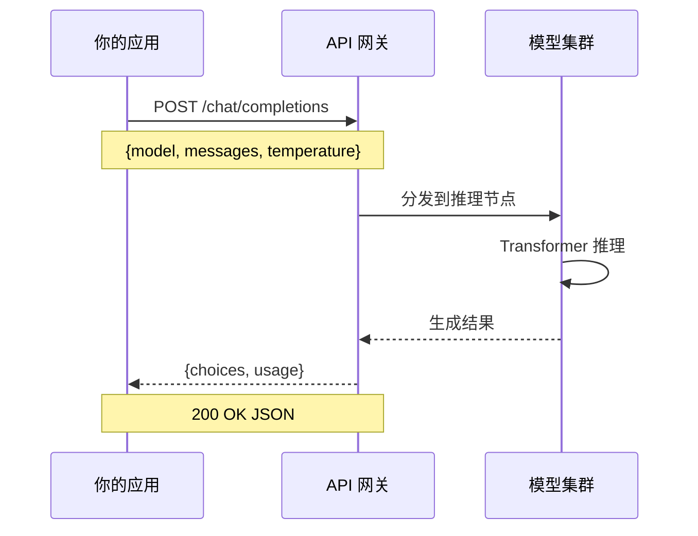

# API 调用基础与流式输出

> ✅ 已学习 — 2026-05-18
>
> 你在 Agent 配置里的每一项操作，最终都会翻译成 HTTP 请求发给模型服务器。
> 本笔记从"API 调用到底在做什么"开始，覆盖你日常调用的所有关键细节。

---

## 一句话本质



**API 调用 = 发一个 HTTP POST 请求给模型服务器 → 等它算完 → 拿回结果**

```
你的应用 → 组装请求（模型 + 消息 + 参数） → POST → 服务器
你的应用 ← 解析响应（生成的文本）         ← JSON ← 服务器
```

---

## 请求和响应的完整结构

### 请求体（你发出去的）

```json
{
  "model": "deepseek-chat",
  "messages": [
    {"role": "system", "content": "你是一个友好的助手。"},
    {"role": "user", "content": "你好，今天天气怎么样？"}
  ],
  "temperature": 0.7,
  "max_tokens": 4096,
  "top_p": 1,
  "stream": false
}
```

### 响应体（你收到的）

```json
{
  "id": "chatcmpl-xxx",
  "object": "chat.completion",
  "choices": [
    {
      "index": 0,
      "message": {
        "role": "assistant",
        "content": "你好！今天天气很好，阳光明媚。"
      },
      "finish_reason": "stop"
    }
  ],
  "usage": {
    "prompt_tokens": 25,
    "completion_tokens": 10,
    "total_tokens": 35
  }
}
```

### 关键字段

| 字段 | 含义 | 你在 Agent 配置里对应的项 |
|---|---|---|
| `model` | 选哪个模型 | 模型选择下拉框 |
| `messages` | 完整的对话历史 | 对话上下文 |
| `temperature` | 回答随机性 | 温度滑块 |
| `max_tokens` | 回答长度上限 | 最大 Token 数 |
| `stream` | 是否流式输出 | 流式输出开关 |
| `usage.total_tokens` | 这次调用花了多少钱 | 账单 |
| `choices[0].message.content` | 模型生成的回答 | 你看到的文字 |

---

## 核心概念

### 1. API 是"失忆"的——每次调用都要传完整历史

```
❌ 错误做法：
  第一次：{"messages": [{"user": "你好"}]}           → 回："你好"
  第二次：{"messages": [{"user": "我刚才说了什么"}]}  → 回："我不知道"

✅ 正确做法：
  第三次：{"messages": [{"user": "你好"}, {"assistant": "你好"}, {"user": "我刚才说了什么"}]}
                                                      → 回："你说了你好"
```

**代价：** 对话越长 → 每次传入的历史 token 越多 → 越贵、越慢。

**你的 Agent 里的"记忆轮数"就是这个的简化版：** 只保留最近 N 轮，不是全部。

### 2. 三个角色的分工

```json
[
  {"role": "system",    "content": "你是一个翻译助手。"},  ← 系统指令（固定）
  {"role": "user",      "content": "翻译这句话"},          ← 用户输入
  {"role": "assistant", "content": "This is the translation."}  ← 模型回复（历史）
]
```

| 角色 | 作用 | 特点 |
|---|---|---|
| `system` | 设定角色、规则、风格 | 每次调用都传，前缀缓存命中率高 |
| `user` | 用户输入 | 每次不同 |
| `assistant` | 模型的历史回复 | 用于维持上下文 |

### 3. 流式输出（Streaming）

**非流式（stream=false）：**
```
发送请求 → 等 3 秒 → 一次性收到整段文字 → 显示
```

**流式（stream=true）：**
```
发送请求 → 模型算出第一个 token → 立即发回 → 显示第一个字
         → 算出第二个 token → 立即发回 → 显示第二个字
         → ...直到结束
```

**流式的响应格式（SSE, Server-Sent Events）：**

```
data: {"choices":[{"delta":{"role":"assistant"},"index":0}]}
data: {"choices":[{"delta":{"content":"你"},"index":0}]}
data: {"choices":[{"delta":{"content":"好"},"index":0}]}
data: {"choices":[{"delta":{"content":"！"},"index":0}]}
data: [DONE]
```

**你在 Agent 配置里的"流式输出"开关控制的就是这个。**

### 5. 结构化输出（Structured Output）

有时候你不想要模型说人话——你要程序能直接解析的 JSON。

**做法一（用 Prompt 提示）：**
```
System: "请以 JSON 格式输出，包含 name 和 age 字段"
```
模型可能输出：
```
```json\n{\"name\": \"张三\", \"age\": 25}\n```
```
→ 带 markdown 标记，还得再解析一层

**做法二（用 response_format 强制）：**
```json
{
  "model": "deepseek-chat",
  "messages": [...],
  "response_format": {
    "type": "json_object"
  }
}
```
模型一定输出：
```
{"name": "张三", "age": 25}
```
→ 干净 JSON，程序直接 JSON.parse

**什么时候用：**
- 提取结构化信息（邮件抽取、实体识别）
- Agent 工具调用的参数生成
- 需要程序化处理模型输出的场景

### 4. 核心参数

| 参数 | 控制什么 | 常用值 | 备注 |
|---|---|---|---|
| `temperature` | 回答随机性 | 0-2 | 代码=0.1, 创意=0.8, 默认=1 |
| `max_tokens` | 回答长度上限 | 视场景 | 不是"精确长度"，是硬上限 |
| `top_p` | 候选词范围 | 0.9-1 | 只从前 90% 概率的词里选 |
| `stop` | 停止序列 | ["\n\n"] | 遇到这些字符就停止生成 |

---

## 常见的 API 费用计算

```
总费用 = prompt_tokens × 输入单价 + completion_tokens × 输出单价

示例（DeepSeek 为例，价格仅供参考，以官网为准）：
  输入：30 token × ¥0.001/1K = ¥0.00003
  输出：100 token × ¥0.002/1K = ¥0.0002
  单次调用：≈ ¥0.00023

一轮 10 句的对话，第 10 次可能累计几千个 token
  → 单次费用：¥0.00x 级别
  → 日调用 1000 次：几块钱
```

---

## 你在 Agent 配置里看到的，对应到 API 层面是什么

| Agent 配置项 | API 层面 | 关键注意 |
|---|---|---|
| 选择模型 | `model` 参数 | 不同模型价格不同 |
| Temperature | `temperature` 参数 | 值越小回答越确定 |
| 最大 Token | `max_tokens` 参数 | 超了会被截断 |
| 流式输出 | `stream` 参数 | 开/关决定打字机效果 |
| 记忆轮数 | 控制 `messages` 中保留多少轮历史 | 轮数越多越贵 |
| System Prompt | `messages[0]` | 放在最前面 → 缓存命中 |
| 停止词 | `stop` 参数 | 遇到指定词就停 |

---

## 省钱技巧

### 1. 把不变的 System Prompt 放在最前面
```
✅ System（不变→缓存命中）→ User（变化）→ Assistant（历史）
```
### 2. 控制记忆轮数
不需要全部历史时，只传最近几轮。
### 3. 使用缓存
部分 API 对重复前缀有折扣价（DeepSeek 支持）。
### 4. 选择合适的 max_tokens
不需要长回答的任务调小 max_tokens，省输出 token。

---

## 🧪 摸底自测

#### Q1（入门）
> 一次完整的 API 调用经历了哪几步？你发的请求里必须包含哪几个字段？

<details>
<summary>解答</summary>

组装 HTTP POST 请求 → 发送给模型服务器 → 服务器推理 → 返回 JSON 响应 → 解析拿到文本。必须包含：model（指定模型）和 messages（对话内容）。
</details>

#### Q2（进阶）
> 为什么每次调用都要把整个对话历史传过去？不传会怎样？

<details>
<summary>解答</summary>

API 是无状态的——每次调用都是独立的，模型不记得上一次调用。如果不传历史，模型"失忆"。代价：对话越长→传入token越多→越贵越慢。
</details>

#### Q3（提升）
> 流式输出的原理是什么？它在响应格式上和非流式有什么区别？

<details>
<summary>解答</summary>

非流式一次性返回完整 JSON，流式用 SSE 一行一个 token 地推送。流式让用户在第一个 token 算出来时就看到了（打字机效果），而不是等全部算完才显示。
</details>

---

## 参考文献
- OpenAI. (2023). *API Reference*. https://platform.openai.com/docs/api-reference
- DeepSeek. (2024). *API Documentation*. https://platform.deepseek.com/api-docs
- HTML Living Standard. *Server-Sent Events*. WHATWG.

*关联阅读：[[Temperature & Sampling]] · [[AI Agent]] · [[Function Calling]]*
